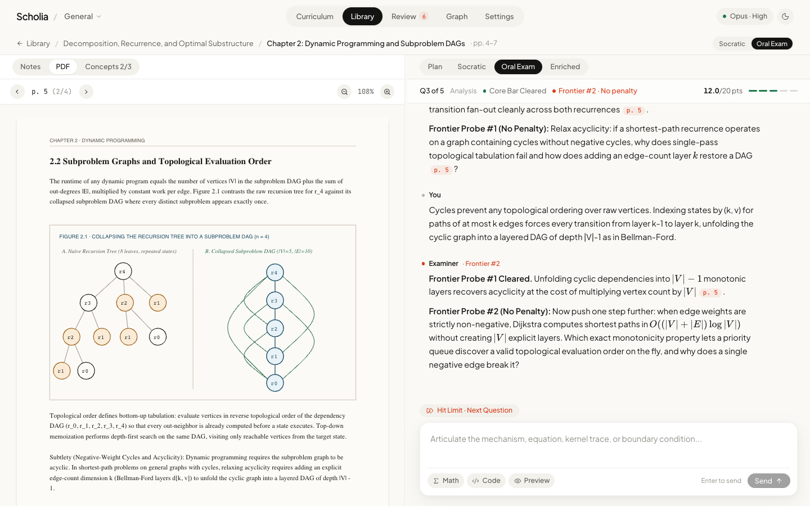
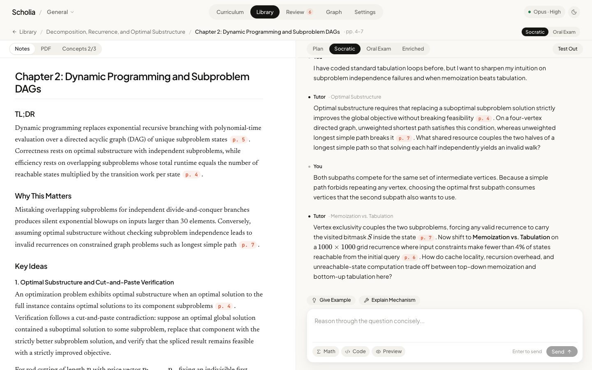
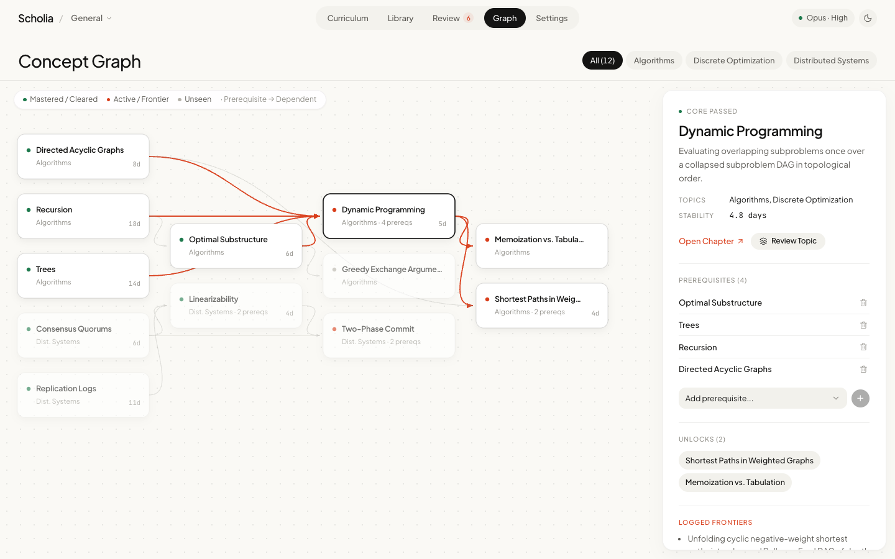
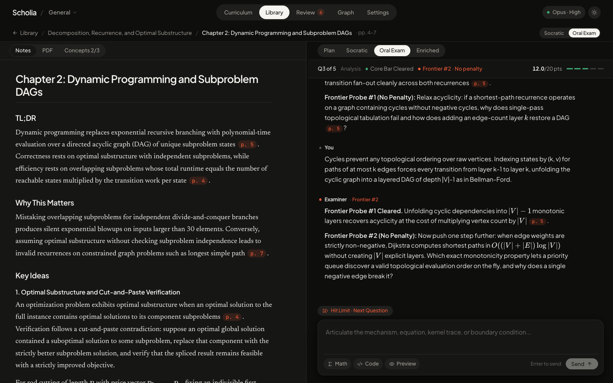

# Scholia

Scholia is a local web application that ingests books, research papers, and static-site technical monographs, extracts chapter-level explanatory notes and lesson plans through locally installed coding-agent command-line interfaces, teaches each chapter through concise Socratic dialogue, and verifies understanding through boundary-probing oral exams. All calls route through existing local installations of `agy` (Antigravity CLI), `claude` (Claude Code), and `codex` so that the learner uses existing agent subscriptions without separate application programming interface keys.



## Why the learning loop is structured this way

Passive reading and compressed highlights produce recognition without recall, leaving a reader unable to reconstruct an argument or derive an edge case weeks later. Scholia separates each chapter into four sequential stages:

1. **Calibration and plan:** The system presents the chapter concept map and prerequisite links from earlier chapters so that the learner can skip already-mastered material or test out immediately.
2. **Concise Socratic dialogue:** The tutor works through unmastered concepts one at a time in two to four sentences ending with a single reasoning question so that the learner stays active rather than reading lectures; clickable page citations jump the source pane directly to the referenced page, and on-demand helpers provide worked examples or mechanism breakdowns when stuck.
3. **Boundary-probing oral exam:** The examiner presents five questions covering explanation, application, analysis, evaluation, and worked synthesis one at a time, grading conceptual reasoning rather than verbatim phrasing; clearing a question's core bar unlocks continuous frontier escalation until the learner reaches the boundary of their knowledge so that gaps are mapped without penalizing the chapter score, while missed core concepts trigger fresh, non-repeating retakes.
4. **Post-session note enrichment:** Passing a chapter appends logged confusions, breakthroughs, and discovered knowledge frontiers to the chapter's persistent Markdown notes so that future review captures what was genuinely difficult.

## Interface views

### Study notes and Socratic dialogue

The left pane switches between extracted Markdown study notes rendered with KaTeX math, the sliced source PDF or rich Markdown text with inline figures, and the ordered concept checklist.



### Cross-book concept graph and spaced retention

Concepts across chapters and books connect inside a multi-parent Directed Acyclic Graph (DAG) rather than a single-parent tree, allowing ideas such as dynamic programming to depend on both recursion and trees. Passing a concept enrolls it into a topic-segmented review queue managed by the Free Spaced Repetition Scheduler (FSRS), with each due review generating a fresh understanding probe instead of repeating static flashcard text.



### Dark mode



## Capabilities and format support

| Area | Behavior in v2 |
|---|---|
| Workspaces and curricula | Top-level umbrella workspaces isolate books, concept graphs, review queues, and multi-phase curricula; individual chapters can be scoped as assigned, optional, or skipped so progress tracks only target reading. |
| Source ingestion | Ingests PDFs with multi-level Table of Contents (TOC) selection, printed-TOC offset detection for bookmarkless files, single-unit collapse for short papers, and 15 to 20 page chunking for multimodal extraction; EPUBs with preserved images, tables, and code blocks; static-site Markdown `.zip` bundles; standalone web URLs; and Markdown or plain text. |
| Agent routing | Discovers local `agy`, `claude`, and `codex` binaries on `PATH` and routes provider, model, and reasoning effort independently across extraction, Socratic dialogue, oral-exam grading, and note enrichment; an offline `demo` engine is included for testing without CLI quota. |
| Local vault and interoperability | Stores books, sliced chapter PDFs, notes, lesson plans, and running logs as readable Markdown and JSON under `~/scholia-vault/workspaces/<workspace>/`, indexed by SQLite and exposed through a companion Model Context Protocol (MCP) server. |

Automated web URL ingestion relies on direct HTTP retrieval and excludes pages behind authentication or client-side rendering.

## Running locally

### Prerequisites

- Python 3.11 or newer
- Node.js 20 or newer
- At least one supported local agent CLI (`agy`, `claude`, or `codex`) on `PATH`, or the built-in `demo` engine for offline evaluation

### Installation

```bash
git clone https://github.com/Dzeddy/Scholia.git
cd Scholia

# Backend
cd backend
python3 -m venv .venv
.venv/bin/pip install -e ".[dev]"

# Frontend
cd ../frontend
npm install
```

### Starting the studio

```bash
# Terminal 1: FastAPI backend (stores data in ~/scholia-vault by default)
cd backend
PYTHONPATH=. .venv/bin/uvicorn scholia.app:app --host 127.0.0.1 --port 8765

# Terminal 2: Vite frontend (http://127.0.0.1:5173)
cd frontend
npm run dev
```

To explore with a synthetic two-volume sample vault without modifying `~/scholia-vault`:

```bash
cd backend
PYTHONPATH=. .venv/bin/python seed_demo.py --vault /tmp/scholia-demo-vault
SCHOLIA_VAULT_DIR=/tmp/scholia-demo-vault PYTHONPATH=. .venv/bin/uvicorn scholia.app:app --host 127.0.0.1 --port 8765
```

### Verification

```bash
cd backend && PYTHONPATH=. .venv/bin/pytest -q
cd frontend && npx tsc --noEmit && npm run build
```

## MCP server registration

The companion MCP server at `backend/mcp_server.py` exposes read and write tools (`list_workspaces`, `list_books`, `get_chapter_notes`, `get_lesson_plan`, `get_learner_memory`, `get_curriculum`, `get_running_log`, `append_running_log`, `log_confusion_or_frontier`, `record_concept_mastery`, `get_due_reviews`, `query_topic_graph`) over stdio or Streamable HTTP. Replace `/path/to/Scholia` with your local clone path.

### Antigravity

```json
{
  "mcpServers": {
    "scholia": {
      "command": "/path/to/Scholia/backend/.venv/bin/python",
      "args": ["/path/to/Scholia/backend/mcp_server.py", "--transport", "stdio"],
      "env": {
        "PYTHONPATH": "/path/to/Scholia/backend",
        "SCHOLIA_VAULT_DIR": "~/scholia-vault"
      }
    }
  }
}
```

### Claude Code

```bash
claude mcp add scholia -- \
  env PYTHONPATH=/path/to/Scholia/backend \
  SCHOLIA_VAULT_DIR=~/scholia-vault \
  /path/to/Scholia/backend/.venv/bin/python \
  /path/to/Scholia/backend/mcp_server.py --transport stdio
```

### Codex (`~/.codex/config.toml`)

```toml
[mcp_servers.scholia]
command = "/path/to/Scholia/backend/.venv/bin/python"
args = ["/path/to/Scholia/backend/mcp_server.py", "--transport", "stdio"]

[mcp_servers.scholia.env]
PYTHONPATH = "/path/to/Scholia/backend"
SCHOLIA_VAULT_DIR = "~/scholia-vault"
```
